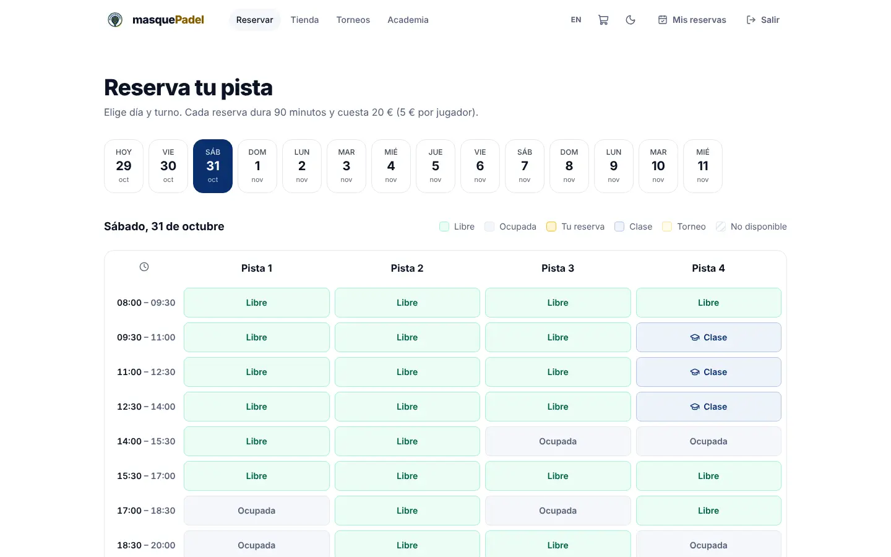
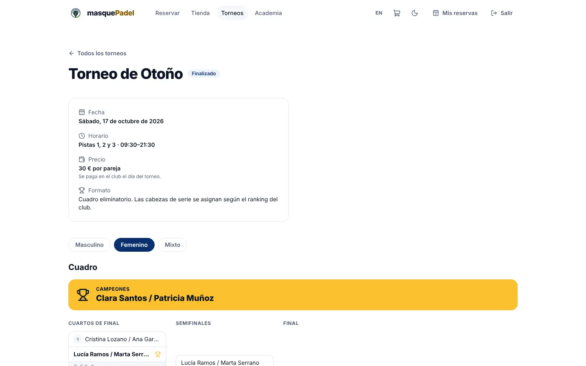
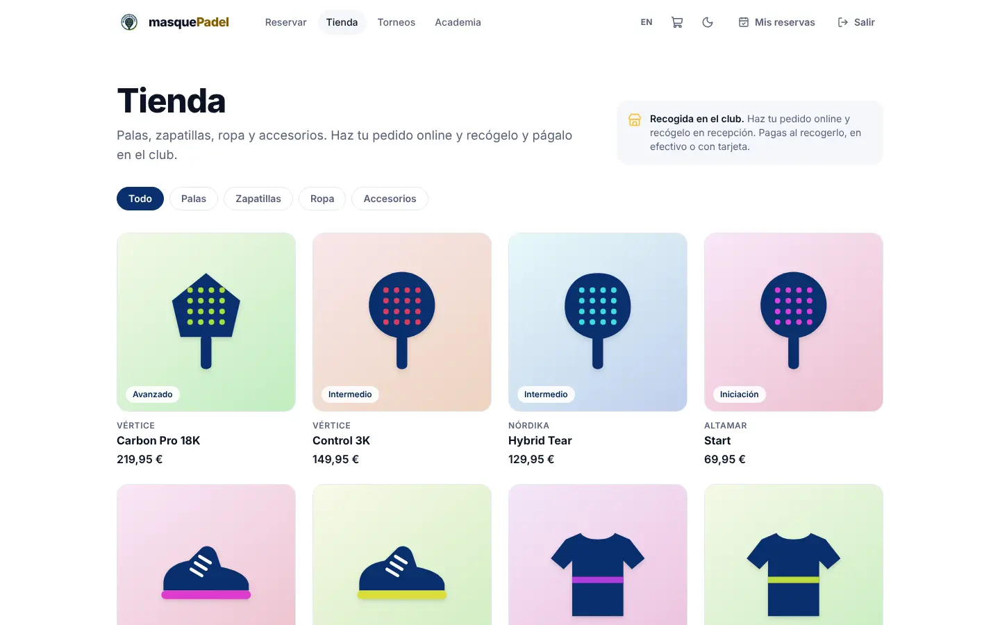
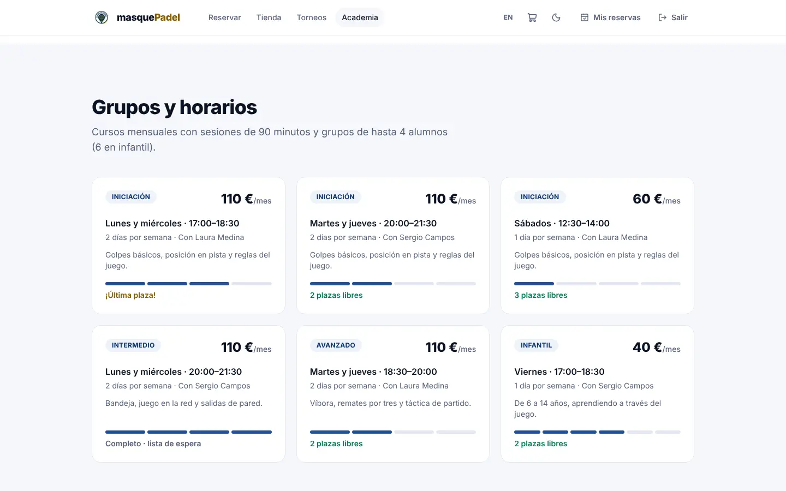
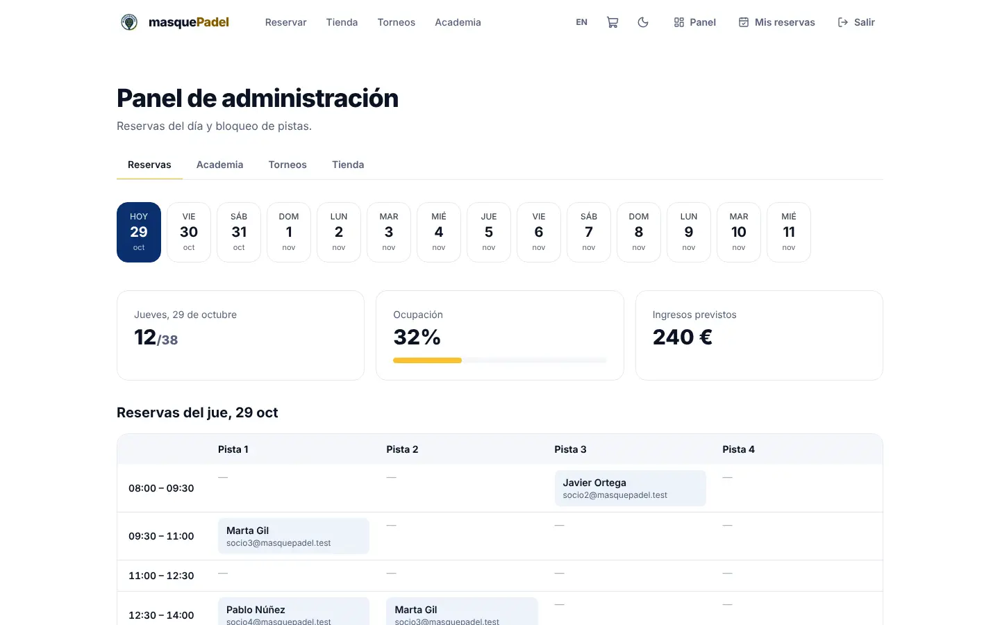

# 🎾 masquePadel

**Web completa para un club de pádel en Sevilla**: reserva de pistas, academia, torneos con ranking y tienda online, con su panel de administración. En español e inglés, con modo claro y oscuro, y adaptada a móvil.

> Proyecto de portfolio: el club, sus datos y los productos son ficticios.

**🔗 Demo:** [masque-padel-yoji.vercel.app](https://masque-padel-yoji.vercel.app)


---

## ✨ Qué hace

| Módulo | Para el jugador | Para el club (panel) |
|---|---|---|
| **Reservas** | 4 pistas, turnos de 90 min de 08:00 a 21:30, hasta 14 días vista. Cancelación gratuita hasta 24 h antes. Máximo 3 reservas activas. | Ocupación e ingresos del día, quién ha reservado cada hueco, anular reservas y bloquear pistas. |
| **Academia** | Cursos mensuales por niveles. Solicitud online (con o sin cuenta) y prueba de nivel gratuita los sábados. | Grupos con ocupación, quién viene a cada prueba de nivel, asignar nivel y grupo o lista de espera. |
| **Torneos** | Inscripción por parejas (masculino, femenino, mixto), cuadro eliminatorio en directo y ranking individual del club. | Crear torneos, generar el cuadro con cabezas de serie según el ranking y anotar resultados (los ganadores avanzan solos). |
| **Tienda** | Palas, zapatillas, ropa y accesorios con stock por talla. Carrito, pedido con código de recogida y pago en el club. | Pedidos por estado (listo, entregado, cancelar) y gestión de productos, precios y stock. |

Los cuatro módulos comparten las pistas: las clases y los torneos ocupan sus turnos y aparecen como **Clase** o **Torneo** en el calendario de reservas, así que nunca se solapan.

| Reservas | Torneo | Tienda |
|---|---|---|
|  |  |  |

| Academia | Panel de administración | Móvil · modo oscuro |
|---|---|---|
|  |  |  |

## 🛠️ Cómo está hecha

- **Next.js 15** (App Router, Server Components y Server Actions) con **React 19** y **TypeScript** estricto.
- **Tailwind CSS 4** con una identidad propia: el azul marino y el amarillo del logo, en modo claro y oscuro.
- **Supabase** (PostgreSQL + Auth) como base de datos, con **Row Level Security** en todas las tablas. Las operaciones delicadas, como descontar stock, generar el cuadro o cancelar devolviendo stock, se hacen en funciones SQL atómicas.
- **Modo demostración sin base de datos:** si no hay claves de Supabase, cada visitante tiene su propio club de prueba en una cookie firmada (HMAC). Así funciona igual en local que en Vercel, donde cada petición puede ir a un servidor distinto.
- **Internacionalización** propia (rutas `/es` y `/en`) y zona horaria de Sevilla en todos los cálculos de horarios, incluido el cambio de hora.
- **Calidad:**
  - tests unitarios con **Vitest** para turnos, zona horaria, reglas de reserva, cuadros, ranking y carrito;
  - pruebas completas en navegador con **Playwright**, alternando dos servidores para simular Vercel;
  - auditoría de accesibilidad con **axe** (WCAG 2 AA, sin errores en modo claro ni oscuro).
- **SEO:** metadatos por página, imagen para compartir generada con los colores del club, `sitemap.xml`, `robots.txt` y datos estructurados de schema.org.
- **Legal:** aviso legal, privacidad y cookies. Solo usa cookies técnicas y el mapa de Google no se carga hasta que el visitante lo pide, así que no necesita banner de consentimiento.

### Decisiones de diseño

- **Las reglas viven en un solo sitio.** La lógica de negocio (`src/lib/*.ts`) es independiente de dónde se guardan los datos (`src/lib/data/`), así que el modo demo y Supabase cumplen exactamente las mismas reglas. Además, Supabase las vuelve a aplicar con RLS, por si alguien llama a la API directamente.
- **No se confía en el navegador.** El carrito vive en el navegador por comodidad, pero el servidor recalcula precios y stock antes de crear el pedido.
- **Toda la configuración del club está en código legible:**
  - horario, precios y reglas en [`src/lib/club.ts`](src/lib/club.ts);
  - grupos y entrenadores de la academia en [`src/lib/academy.ts`](src/lib/academy.ts);
  - pistas y puntos de los torneos en [`src/lib/tournaments.ts`](src/lib/tournaments.ts).

## 🚀 Arrancar en local

```bash
npm install
npm run dev
```

Abre http://localhost:3000. Sin configurar nada arranca en **modo demostración**, con reservas, alumnos, torneos jugados y catálogo de ejemplo:

| Cuenta | Email | Contraseña |
|---|---|---|
| Jugador | `jugador@masquepadel.test` | `padel1234` |
| Administrador | `admin@masquepadel.test` | `admin1234` |

Para empezar de cero, borra las cookies del sitio.

### Con Supabase

1. Crea un proyecto gratuito en [supabase.com](https://supabase.com).
2. En el *SQL Editor*, ejecuta en orden los archivos de [`supabase/migrations/`](supabase/migrations/):
   - `0001_reservas.sql`
   - `0002_academia.sql`
   - `0003_torneos.sql`
   - `0004_tienda.sql` (incluye un catálogo de ejemplo)
3. Copia `.env.example` a `.env.local` y rellena `NEXT_PUBLIC_SUPABASE_URL` y `NEXT_PUBLIC_SUPABASE_ANON_KEY`. En Vercel van en *Settings → Environment Variables* como tipo *Config*.
4. En *Authentication → URL Configuration*, pon la URL de tu web como *Site URL*.
5. Regístrate en la web y hazte administrador:
   ```sql
   update profiles set role = 'admin' where email = 'tu@email.com';
   ```

## 📜 Scripts

| Comando | Qué hace |
|---|---|
| `npm run dev` | Servidor de desarrollo |
| `npm run build` / `npm start` | Compilación y servidor de producción |
| `npm run lint` | ESLint |
| `npm test` | Tests unitarios (Vitest) |

## 📁 Estructura

```
src/
  app/[locale]/          páginas en es/en: portada, reservas, academia, torneos, tienda, mis-reservas, admin, legal
  app/actions.ts         acciones de servidor (login, reservar, inscribirse, pedir, gestionar…)
  components/            cabecera, calendario, cuadro de torneo, carrito, formularios…
  lib/                   reglas de negocio: club, slots, bookings, academy, tournaments, shop
  lib/data/              almacenamiento: modo demo (cookies firmadas) y Supabase
  lib/i18n/              textos en español e inglés
supabase/migrations/     esquema SQL con RLS y funciones
legacy-java/             primera versión del proyecto (aplicación de escritorio en Java Swing)
```

---

**Autor:** [Adan Gavira](https://github.com/AdanGavira)
